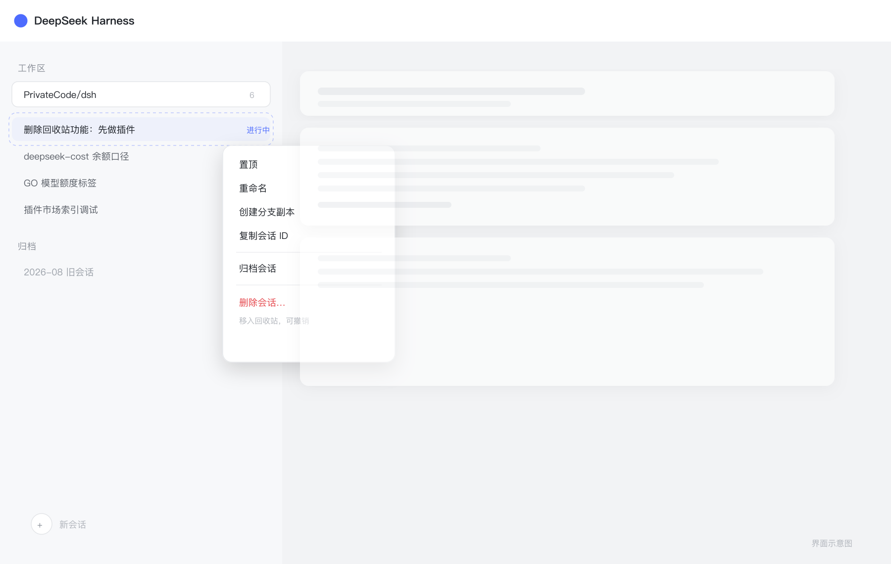
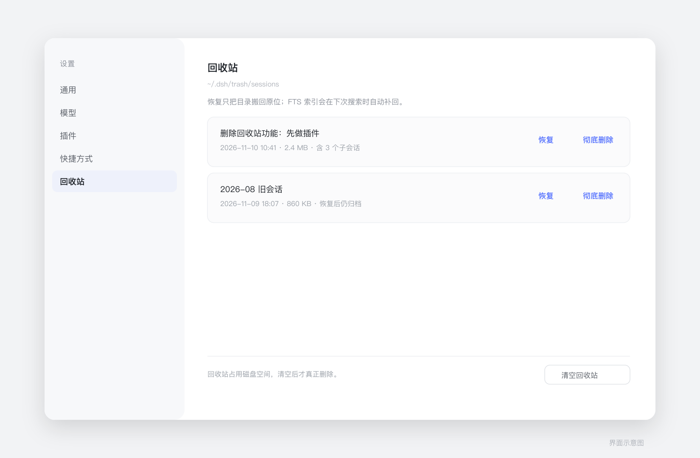

# @skyrocks/dsh-session-trash

Real session deletion for [DeepSeek Harness](https://github.com/deepseek-ai/deepseek-harness) (`dsh`):
right-click a session → **Delete session…** moves it to the trash; undo from the toast, or
restore / purge it later under **Settings → Trash**.

DSH ships **archive** only: archiving hides a session and blocks further runs, but its log keeps
occupying disk. This plugin makes deletion a two-step action — move to trash first, then decide
whether to empty it — so a mis-click is never final.

<p align="center">
  
</p>

<p align="center">
  
</p>

> The screenshots are UI mockups; the real styling follows the DSH theme (light / dark).

## Install

Local development (link):

```sh
dsh plugin --profile desktop add "link:/Users/shilei/PrivateCode/dsh/dsh-session-trash"
```

Once published, follow the default branch:

```sh
dsh plugin --profile desktop add github:skyrocks/dsh-session-trash
```

Fully quit and reopen DSH afterwards (Host plugins load at startup). `dsh web` users replace
`--profile desktop` with `--profile web`.

## Usage

1. **Right-click a session** → **Delete session…** at the bottom of the menu.
2. Confirm **Move to trash**: the session leaves the sidebar and its directory is moved to
   `~/.dsh/trash/sessions/<deletedAt>-<rootSessionId>/`.
3. Click **Undo** on the toast: the directory is moved back together with its archive/pin state.
4. Missed the toast? **Settings → Trash** lists every entry with **Restore** and **Delete forever**,
   plus **Empty trash**.

**Subagent children go with their parent.** Deleting a parent moves its `origin === 'subagent'`
descendants into the same trash entry, and a restore brings them back together — no orphaned lineage.
Forks are independent sessions and are left alone.

## What is refused, and why

| Case | Message | Reason |
| --- | --- | --- |
| The session (or a child) is open in this process | switch away or restart | the write handle still holds the kernel lock |
| The session still has running work | lists turns / subagents / jobs / schedules | reuses the archive activity check, so nothing running is deleted |

Unarchived sessions can be deleted too: the plugin archives each of them first (that is where the
activity check happens), rolls the whole operation back if any of them is refused, and clears the
archive/pin markers only after the move.

## Configuration

Override by id in the profile's `cordis.patch.yml`:

```yaml
- id: session-trash
  config:
    retentionDays: 0        # >0 removes entries older than N days when Trash is listed; 0 = never
    trashRoot: ""           # custom trash root; empty = <DSH_HOME>/trash/sessions
```

## Data and recovery

```text
~/.dsh/trash/sessions/<deletedAt>-<rootSessionId>/
  meta.json                        # root id/title/cwd, deleted-at, total bytes, and per-session original path + archive/pin state
  sessions/<escaped-session-id>/…  # each deleted session directory, moved as a whole
```

- **Restore depends only on `meta.json`**: every directory is moved back and the archive/pin markers
  are re-applied per session. No in-memory state, so it still works after a restart or an upgrade.
- **Restore pre-checks everything**: if any target path is occupied the whole entry is left alone —
  never a half-restore.
- Manual rescue works too: `mv` the directories back; `meta.json` is plain JSON.
- The SQLite FTS index reconciles itself on the next search — no reindex after a restore.
- When the session root and the trash root live on different volumes, the move degrades to
  copy + delete (`EXDEV`).

## Known trade-offs

- **A dangling id may remain in `workspace.json`**: the Workspace registry has no public API to drop
  a membership slot. The sidebar filters ids without a summary, so nothing is visible; the workspace
  only keeps one empty ordering slot.
- **Attachments are not deleted**: they are content-addressed and shared across sessions
  (`~/.dsh/attachments/v1/objects`). Reclaiming them needs a separate GC.
- **Deleting the current session is refused** — switch away first. A log being written must not be
  moved from under its writer.
- **The list refreshes actively**: persistence emits no removal event, so the plugin calls
  `sessions.refresh()` once. In rare cases a page refresh may be needed.

## Compatibility

| Item | Requirement |
| --- | --- |
| DSH | `>= 0.2.1-rc.3 < 0.3.0` (verified against `0.2.2-rc.1` desktop) |
| Node | `>= 18` (the desktop app ships Node 24) |
| Runtime dependencies | none; only host-provided peers (cordis / schemastery / typert-protocol / react) |

## Development

```sh
node test/smoke.mjs      # 19 cases: trash round-trip/cascade/rollback, restore conflict, retention, orchestration, client wiring, naming
node test/manifest.mjs   # entries, files whitelist, patch row name, typert manifest
```

| File | Role |
| --- | --- |
| `index.js` | Host service (`sessionTrash`): serialization, service wiring, typert exposure |
| `session-ops.js` | Delete/restore orchestration: lineage, archive checks with rollback, marker cleanup (pure, injectable) |
| `trash.js` | Trash filesystem: move in, restore, purge, path validation, cross-volume fallback |
| `typert.host.js` | Host invocation manifest (list/delete/restore/purge/purgeAll) |
| `client.js` | Context menu, confirm dialog, undo toast, Settings trash panel |
| `test/smoke.mjs` | Pure logic regression, no DSH runtime required |
| `test/manifest.mjs` | Pre-release self-check of entries and manifests |

## Privacy

No network calls, no telemetry. Reads and writes only under `~/.dsh`: session log directories and
`~/.dsh/trash`.
