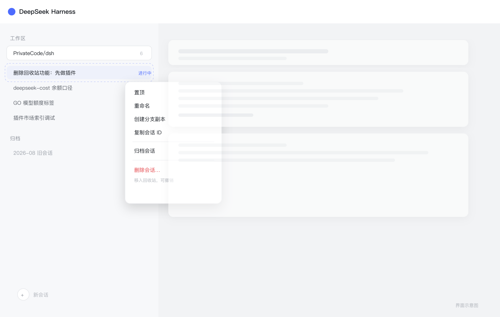
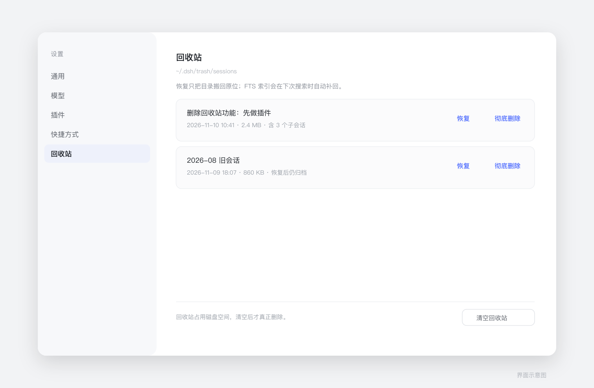

# @skyrocks/dsh-session-trash

[](https://github.com/skyrocks/dsh-session-trash/actions/workflows/ci.yml)


给 [DeepSeek Harness](https://github.com/deepseek-ai/deepseek-harness)（`dsh`）补上真正的会话删除：
右键「删除会话…」先移入回收站，可即时撤销，也能在「设置 → 回收站」里恢复或彻底删除。

DSH 内置只有「归档」——归档只是把会话藏起来并拦住后续运行，日志仍然占着磁盘。这个插件把删除做成
两步：先搬进回收站，再决定要不要清空，避免误点一下就没有了。

<p align="center">
  
</p>

<p align="center">
  
</p>

> 截图为界面示意图，实际样式跟随 DSH 主题（明 / 暗）。

## 安装

本机开发用 link：

```sh
dsh plugin --profile desktop add "link:/Users/shilei/PrivateCode/dsh/dsh-session-trash"
```

发布后可以跟随 GitHub 默认分支：

```sh
dsh plugin --profile desktop add github:skyrocks/dsh-session-trash
```

装完**完全退出 DSH 再打开**（Host 插件只在启动时加载）。`dsh web` 用户把
`--profile desktop` 换成 `--profile web`。

## 怎么用

1. **右键会话** → 菜单最下面「删除会话…」。
2. 确认框里点「移入回收站」：会话从侧栏消失，目录整体搬到
   `~/.dsh/trash/sessions/<删除时间>-<会话 id>/`。
3. 提示条上直接点「撤销」，目录原样搬回，归档/置顶状态也一起还原。
4. 错过撤销也没关系：**设置 → 回收站**，每行都有「恢复」和「彻底删除」，也可以一次清空。

**子会话跟着一起走**：删除父会话时，它的 subagent 后代（`origin === 'subagent'`）会进入同一个
回收站条目，恢复时一起回来，不会留下孤儿 lineage。fork 出来的会话算独立会话，不会被带走。

## 会拒绝的两种情况

| 情况 | 表现 | 为什么 |
| --- | --- | --- |
| 会话（或它的子会话）正在本机打开着 | 提示先切走或重启 | 写句柄还持有内核锁，边写边删会互相踩 |
| 会话还有运行中的工作 | 提示列出回合 / 子会话 / 后台任务 / 定时任务 | 复用归档自带的活动检查，避免删掉正在跑的东西 |

未归档的会话也能直接删：插件会先替你逐个归档（活动检查就在这一步），任何一个被拒就整体回滚，
全部成功后才清掉归档 / 置顶标记。

## 配置

在 profile 的 `cordis.patch.yml` 里按 id 覆盖：

```yaml
- id: session-trash
  config:
    retentionDays: 0        # >0 时，打开回收站会顺带清理超过 N 天的条目；0 = 不自动清理
    trashRoot: ""           # 自定义回收站目录；空 = <DSH_HOME>/trash/sessions
```

## 数据与恢复

```text
~/.dsh/trash/sessions/<deletedAt>-<rootSessionId>/
  meta.json                        # 根会话 id/标题/cwd、删除时间、总字节数，以及每个会话的原路径与归档/置顶状态
  sessions/<escaped-session-id>/…  # 每个被删会话的目录，整体搬入
```

- **恢复只依赖 `meta.json`**：逐个搬回原路径，再按每条会话的 `wasArchived` / `wasPinned` 补回标记。
  不依赖进程内存，重启或换版本后都还能恢复。
- **恢复前整体预检**：任何一个目标位置被占用，整条中止，不会只恢复一半。
- 手动救援也可以：`mv` 回原路径即可，`meta.json` 是纯文本。
- 搜索索引（SQLite FTS）会在下次搜索时自动对账，恢复后不用手动重建。
- 会话目录和回收站不在同一个磁盘时自动退化为「复制 + 删除」（`EXDEV`）。

## 已知取舍

- **`workspace.json` 可能留一个悬空 id**：Workspace 注册表没有「移除成员槽位」的公开 API。
  前端会把没有 summary 的 id 过滤掉，侧栏视觉无影响；只是那个工作区的排序槽位会留下一条空记录。
- **不删附件**：附件是内容寻址共享的（`~/.dsh/attachments/v1/objects`），多个会话共用，
  不能跟着单个会话删。要回收这部分空间需要单独的 GC，不在本插件范围。
- **删除当前的会话会被拒绝**：请先切到别的会话。这是有意的——正在写的日志不该被搬走。
- **删除后列表靠主动刷新**：持久化层没有「删除事件」，插件会调一次 `sessions.refresh()`
  重新对账；极端情况下（Host 卡顿）需要手动刷新页面。
- **搬运失败会保留现场**：如果搬到一半失败、而且回滚也失败（权限 / IO 故障），插件**不会清理**
  已经进回收站的数据，而是留下 `meta.json`（`incomplete` + 每个会话的原路径与失败原因），
  设置页里该条目标黄提示，「彻底删除」需要二次确认。过期清理也会跳过这类条目。

## 兼容性

| 项目 | 要求 |
| --- | --- |
| DSH | `>= 0.2.1-rc.3 < 0.3.0`（验证于 `0.2.2-rc.1` 桌面端） |
| Node | `>= 18`（桌面版内置 Node 24） |
| 运行时依赖 | 无；只用到 DSH 已提供的 peer（cordis / schemastery / typert-protocol / react） |

## 开发

```sh
node test/smoke.mjs      # 19 项：回收站往返/级联/回滚、恢复冲突、保留期清理、编排、client 接线、包名一致性
node test/manifest.mjs   # 入口、files 白名单、插件行名、typert 清单
```

结构：

| 文件 | 作用 |
| --- | --- |
| `index.js` | Host 服务（`sessionTrash`）：串行化、服务接线、typert 暴露 |
| `session-ops.js` | 删除/恢复的编排：血缘收集、归档检查与回滚、标记清理（纯依赖注入，可单测） |
| `trash.js` | 回收站文件系统：搬入、恢复、清理、路径校验、跨盘退化 |
| `typert.host.js` | Host 调用清单（list/delete/restore/purge/purgeAll） |
| `client.js` | 右键菜单、确认弹窗、toast 撤销、设置页回收站面板 |
| `test/smoke.mjs` | 纯逻辑回归，不依赖 DSH 运行时 |
| `test/manifest.mjs` | 发布前自检：入口与清单一致性 |

## 隐私

不联网、不发送遥测。只在 `~/.dsh` 下读写：会话日志目录与 `~/.dsh/trash`。
